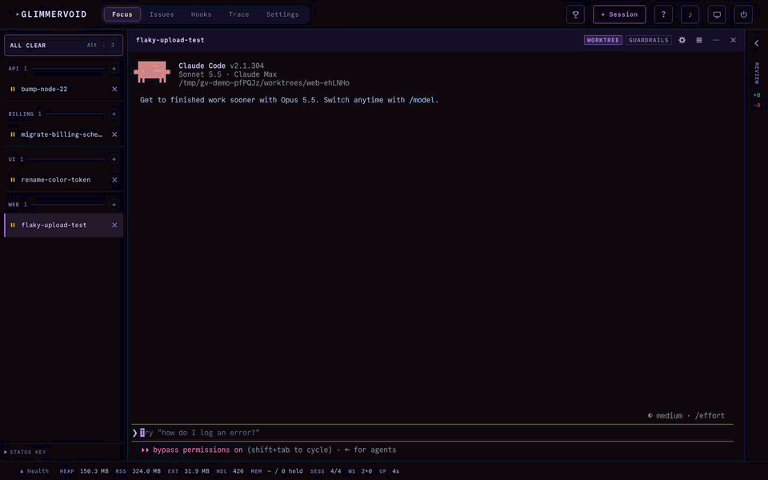

# Glimmervoid

[](https://github.com/johncwaters/glimmervoid/actions/workflows/test.yml)
[](https://www.npmjs.com/package/glimmervoid)
[](https://opensource.org/licenses/MIT)
[](https://nodejs.org)
[](https://github.com/johncwaters/glimmervoid)

**Mission control that ships. Not a terminal multiplexer. Grids are for watching. This is for shipping.**

[glimmervoid.dev](https://glimmervoid.dev)

Glimmervoid takes a feature from start to finish. Every agent works in its own git worktree, status comes from the agent's own hooks, and the one session that needs you comes to the front. Review and merge from the same page.

It is an orchestrator, not a harness. Claude Code, Codex and Grok run unmodified, as real processes in real terminals on your own machine. No cloud service, no account. Glimmervoid is developed inside Glimmervoid.



## Quickstart

**1. Start it.** Windows and macOS:

```bash
npx glimmervoid@latest
```

Linux, where node-pty compiles at install time:

```bash
sudo apt install build-essential python3 git
npx --allow-scripts=node-pty glimmervoid@latest
```

**2. Open http://localhost:3000.** The first start from a terminal opens it in your browser for you; pass `--no-open` to skip that.

**3. Follow the checklist.** The empty dashboard walks you through three steps: an agent CLI it can find, the folder that holds your git checkouts, and your first session. It suggests folders such as `~/Projects` that already hold git repos, or you can type a path. Each subfolder becomes a project. For a folder outside your repository roots, open **Run in a folder outside your repository roots** in the **+ Session** dialog.

That is the whole setup. Allow notifications when the dashboard asks, and keep a dashboard tab open: a notification appears whenever that tab is in the background, unless Streamer mode is on.

Keep `@latest` so npx picks up new releases. To install globally instead, run `npm install -g glimmervoid` (add `--allow-scripts=node-pty` on Linux), then `glimmervoid`. Never use `sudo npm`; see [EACCES on a global install](docs/troubleshooting.md#eacces-on-a-global-install).

If something fails, run `glimmervoid doctor` and see [troubleshooting](docs/troubleshooting.md).

### From source

```bash
git clone https://github.com/johncwaters/glimmervoid.git
cd glimmervoid
npm ci
npm run build
npm start
```

To update, run `git pull --ff-only && npm ci && npm run build` and restart. The dashboard's update banner shows the right command for however you installed.

## Requirements

- **Node.js 22.18 or newer.** Distro-packaged Node is usually older; use nvm, NodeSource or the official installer.
- **Windows 11, Linux or macOS.** CI runs on Linux; Windows and macOS are tested by hand.
- **An agent CLI** on PATH: Claude Code, Codex, Grok or another terminal agent.
- **git** on PATH, for per-session worktrees.
- **Linux only:** `build-essential` and `python3` to compile node-pty, plus `bubblewrap`, `socat` and `ripgrep` for session guardrails (`sudo apt install bubblewrap socat ripgrep`).

`glimmervoid doctor` checks all of these.

## Supported agents

| Agent | Command | Status from |
|-------|---------|-------------|
| Claude Code (default, most complete) | `claude` | Hooks, with background agent gating and auto-resume |
| Codex CLI | `codex` | Hooks. Codex has no notification event, so a question asked in prose looks like a finished turn |
| Grok Build | `grok` | Hooks, after running `glimmervoid agent setup grok` once |
| Any other terminal agent | your own | Terminal title only |

Declare another agent under `customAgents` in `config.json` with an `id`, `label` and `command`, plus optional `args`, `idleTitle` and `busyTitle`. The **+ Session** dialog offers only the agents it finds on PATH, and a project can default to one with `projects[].agent`.

## Features

- **Focus view.** A rail of every session on the left, the selected session's live terminal in the middle, its changes on the right. The top of the rail counts what needs you, and `Cmd/Alt+J` jumps straight to the next one from any tab.
- **A worktree per agent.** Every session in a git repo gets its own worktree, so agents never step on your checkout or each other. Review the diff and merge with one click while the agent keeps working. A conflicted merge parks, and **Resolve in session** hands it back to the agent that wrote it.
- **Exact status.** Hooks report every state change and the terminal title fills the gaps. The screen is never scraped ([how](#how-status-detection-works)).
- **Notifications.** Browser notifications when a session needs input, finishes or fails, with your own alert sounds if you like (drop `.ogg`, `.mp3`, `.wav`, `.m4a` or `.webm` files into `~/.glimmervoid/sounds/`). Telegram covers you when no dashboard is open.
- **Phone layout.** Board, terminal and review screens, attention first, with a terminal that resizes around the keyboard.
- **Plan review.** Read, edit and approve Claude Code plans from the dashboard or your phone.
- **Guardrails.** Guarded Claude Code sessions on macOS and Linux (on unless a project or folder opts out) cannot touch credentials or Glimmervoid's own state, and Sane YOLO, once its hooks are installed and trusted, refuses commands like `git reset --hard` and `git push --force` in sessions that skip permission prompts.
- **Usage.** Tokens and estimated cost from local Claude Code, Codex and Grok transcripts, with optional budgets.
- **Auto-resume.** Sessions live when Glimmervoid stopped come back with their conversation resumed.
- **Remote access** (opt-in). Reach the dashboard from another device through single-use pairing links.
- **Radar** (opt-in). Watches PostHog error tracking, pings Telegram on a spike, regression or new issue, and sends an agent to investigate. Optional auto-fix opens a pull request the agent can never push or merge itself.
- **Team PR review** (opt-in). Drafts a review of each open pull request from a GitHub team in a guarded agent, optionally with your own review skill. Nothing posts until you choose Approve or Comment.

### Keyboard

Cmd on a Mac, Alt elsewhere:

| Keys | Action |
|------|--------|
| `Cmd/Alt+J` | Next session that needs you |
| `Cmd/Alt+1` to `9` | Jump to a session |
| `Cmd/Alt+Up` / `Down` | Move through the rail |
| `Cmd/Alt+I` | Merge the selected session |
| `Cmd/Alt+U` | Resolve a parked merge, or resync the base branch |
| `Cmd/Alt+0` | Add a session |

## Commands

```
glimmervoid                    # start the server on port 3000
glimmervoid --port 3001        # start on another port
glimmervoid doctor             # check the install, PATH, agents and native module
glimmervoid settings list      # read and change settings from the terminal
glimmervoid pair --name phone  # pair a remote device
```

`glimmervoid --help` lists every command.

## Configuration

Glimmervoid creates `~/.glimmervoid/config.json` on first run. Most settings live in the dashboard's **Settings** view; the rest you can change with `glimmervoid settings` or by editing the file, which the server reloads on save. Every key, default and environment variable is in the [configuration reference](docs/configuration.md), generated from the code.

Worktrees branch from each repo's default branch (`origin/HEAD`, then `main`, then `master`) unless you set `integrationBranch`.

Glimmervoid sends anonymous usage and error data by default. [Telemetry](docs/configuration.md#telemetry) lists exactly what is sent and how to turn it off.

## How status detection works

The obvious way to tell whether an agent is working, waiting or done is to scrape the terminal for a prompt or a spinner. That breaks on every redraw, theme change and CLI release, so Glimmervoid never does it.

Instead, each session gets Claude Code hooks scoped to that one session, with no change to your repo. They POST every lifecycle event to a local endpoint: prompt submitted, turn stopped, notification raised, sub-agent started or finished. Hooks are the authoritative signal. The terminal title (spinner glyph means working, idle glyph means ready) covers anything the hooks miss, and a hook wins any conflict.

Three bugs shaped the details:

- **`/clear` looked like a finished turn.** It fires no hooks but flashes a spinner, then an idle glyph, in the title, so early builds sent "session complete" on every clear. Now a clear or compact resets both signals and mutes the title until the next real prompt.
- **A background sub-agent outlived its parent's turn.** The main agent's `Stop` fired while a sub-agent was still working. Now a session stays out of Complete until the live sub-agent count, reconciled against Claude Code's own `background_tasks` field, reaches zero.
- **Auto-resume silently never ran.** It waited for `SessionStart`, which Claude Code does not reliably fire on interactive startup. Now the conversation id comes from whichever hook arrives first.

Every session writes a JSONL recording of hook payloads and state transitions (never terminal bytes), and a replay harness runs recorded sessions back through the detection code as regression tests.

## Remote access

Off by default. Remote access is a second listener on `127.0.0.1` that you put behind an HTTPS reverse proxy; Glimmervoid never binds a wider address unless `GLIMMERVOID_INSECURE_BIND=1` is set.

1. Add a `remote` block to `~/.glimmervoid/config.json`. `port` must differ from the dashboard port, and `publicHost` is the hostname your proxy serves:

   ```json
   {
     "remote": { "enabled": true, "port": 3456, "publicHost": "my-machine.example.ts.net" }
   }
   ```

2. Restart Glimmervoid. The log shows `Glimmervoid remote listener on http://127.0.0.1:3456 (paired devices only)`.
3. Point an HTTPS reverse proxy at that port. With Tailscale, `tailscale serve --bg 3456` serves `https://<machine>.<tailnet>.ts.net`, which is what `publicHost` should hold.
4. From the device, open `https://<publicHost>/`. You should see Glimmervoid's "Pairing required" page.
5. On the host, run `glimmervoid pair --name phone` and open the printed link on the device. It is single-use and expires in 10 minutes.

`glimmervoid pair --list` shows paired devices, and `glimmervoid pair --revoke <id>` removes one without a restart.

A paired device has full control of the machine as your account, so treat pairing links like passwords. Behind HTTP-mode `tailscale serve`, you can also set `"ownerLogin": "you@example.com"` in the `remote` block so only that Tailscale login gets through, on top of pairing. Only HTTP-mode `tailscale serve` strips a forged `Tailscale-User-Login` header; behind any other proxy, or `tailscale serve --tcp` or `--tls-terminated-tcp`, `ownerLogin` proves nothing.

## Running as a service (Linux)

A systemd user unit keeps Glimmervoid running after you log out:

```ini
# ~/.config/systemd/user/glimmervoid.service
[Unit]
Description=Glimmervoid

[Service]
ExecStart=/usr/bin/env glimmervoid
EnvironmentFile=-%h/.glimmervoid/secrets.env
Restart=on-failure

[Install]
WantedBy=default.target
```

```bash
systemctl --user daemon-reload
systemctl --user enable --now glimmervoid
loginctl enable-linger "$USER"
```

The unit's `PATH` must reach `node`, `glimmervoid` and your agent CLIs. With nvm, set `Environment=PATH=...` or use absolute paths in `ExecStart`. For a source checkout, use `ExecStart=/usr/bin/env node dist/server/index.js` with `WorkingDirectory=` set to the checkout.

`secrets.env` is optional. Put `GLIMMERVOID_POSTHOG_API_KEY` and `GLIMMERVOID_TELEGRAM_BOT_TOKEN` there to keep them out of `config.json`.

## Security

Glimmervoid runs agents with your account's privileges. The local dashboard has no login and binds only `127.0.0.1` unless `GLIMMERVOID_INSECURE_BIND=1` is set, so any local process can drive it and the port must never be exposed to the network. Use [remote access](#remote-access) to reach it from elsewhere.

[SECURITY.md](SECURITY.md) has the full trust model and how to report a vulnerability privately.

## Contributing

See [CONTRIBUTING.md](CONTRIBUTING.md). Release history is in [CHANGELOG.md](CHANGELOG.md).

## License

[MIT](LICENSE)
